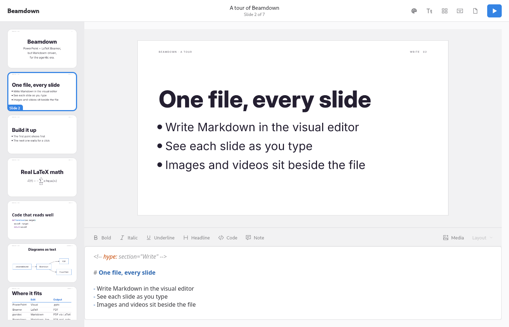
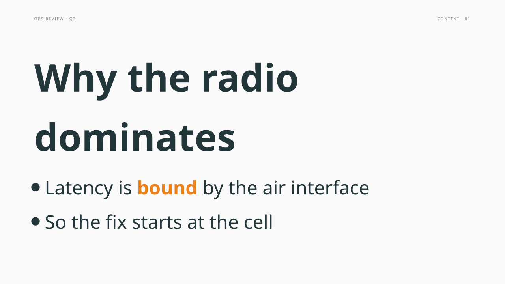

<div align="center">


# Beamdown

**PowerPoint + LaTeX Beamer, but Markdown-driven, for the agentic era.**

A presentation app for GNOME. Your agent drafts the deck in Markdown, following your<br>
brand guidelines. You finish it in a visual editor, and export to PDF or PowerPoint.

<sub>Inspired by <a href="https://github.com/omacom/hype">Hype</a>, which DHH showed in his <a href="https://www.youtube.com/watch?v=vDjW_dRyKXY&t=3081s">Rails World 2026 opening keynote</a>.<br>Beamdown started as a fork of it and has since diverged too much to follow it, so it is now its own app.</sub>

[**Documentation**](https://beamdown.sergiogimenez.com) ·
[Get started](https://beamdown.sergiogimenez.com/start/) ·
[Why Beamdown](https://beamdown.sergiogimenez.com/why/)

<br>

<picture>
  <source media="(prefers-color-scheme: dark)" srcset="docs/assets/editor-dark.png">
  
</picture>

</div>

## How it works

1. **Your agent drafts.** Run `beamdown skill install` once. From your notes and a `BRAND.md` with your colors, type and rules, the agent writes `presentation.md`, checks it with `beamdown check` and looks at every slide.
2. **You make it yours.** `beamdown open` the draft and reorder, retype and restyle it, seeing each slide as you type. The agent can keep editing alongside you.
3. **You present.** Full screen with Presenter View, or export to PDF or PowerPoint.

See [Draft with your agent](https://beamdown.sergiogimenez.com/agents/) for an example `BRAND.md`, a prompt, and the deck it produced.

## Highlights

- **One Markdown file.** Slides are separated by `---`, with images and videos beside the file.
- **Beamer's toolbox.** Build steps with `. . .`, real LaTeX math, sections with a running header and slide numbers, and a PDF page per step.
- **A visual editor.** Live preview, drag-and-drop slides, an overview grid, find in every slide, and Markdown colored as you type.
- **At home on GNOME.** Follows your dark style and accent color, with six slide themes built in, from Adwaita to Metropolis and Beamer blue.
- **Diagrams and code.** Mermaid and SVG in the deck's colors and highlighted code, all kept as vectors in the PDF.
- **PDF and PowerPoint.** Present full screen with Presenter View, or export a file that looks the same anywhere.

## Write this, get slides

```markdown
---
title: "Why the radio dominates"
theme: metropolis
header: "Ops review · Q3"
---

<!-- hype: section="Context" -->

# Why the radio dominates

- Latency is **bound** by the air interface

. . .

- So the fix starts at the cell
```



## Install

Beamdown builds from source with Qt 6.9 or newer, FFmpeg and GNU source-highlight ([full list](https://beamdown.sergiogimenez.com/start/)):

```sh
git clone https://github.com/sergio-gimenez/beamdown.git
cd beamdown
./bin/build
./build/beamdown open examples/tour/presentation.md
```

## Where it comes from

Beamdown is inspired by [Hype](https://github.com/omacom/hype), the Markdown presentation app that David Heinemeier Hansson (DHH) showed in his [Rails World 2026 opening keynote](https://www.youtube.com/watch?v=vDjW_dRyKXY&t=3081s). It started as a fork of Hype. It has since diverged too much to follow upstream: a GNOME look, built-in slide themes, Beamer's toolbox and an agent-first workflow. So it is now its own app, though it still reads and writes Hype's file format, so a presentation opens in either. [Why Beamdown](https://beamdown.sergiogimenez.com/why/) tells the whole story.

Hype's history and MIT license come with the fork; see [LICENSE](LICENSE).
