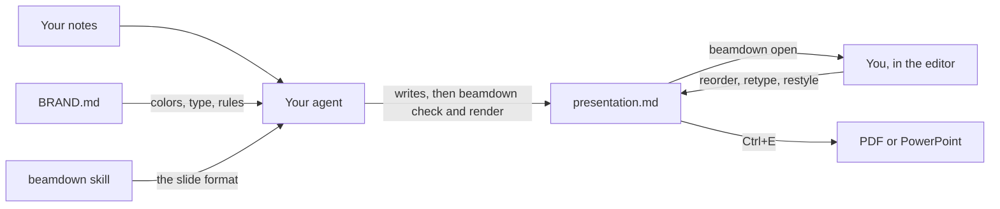
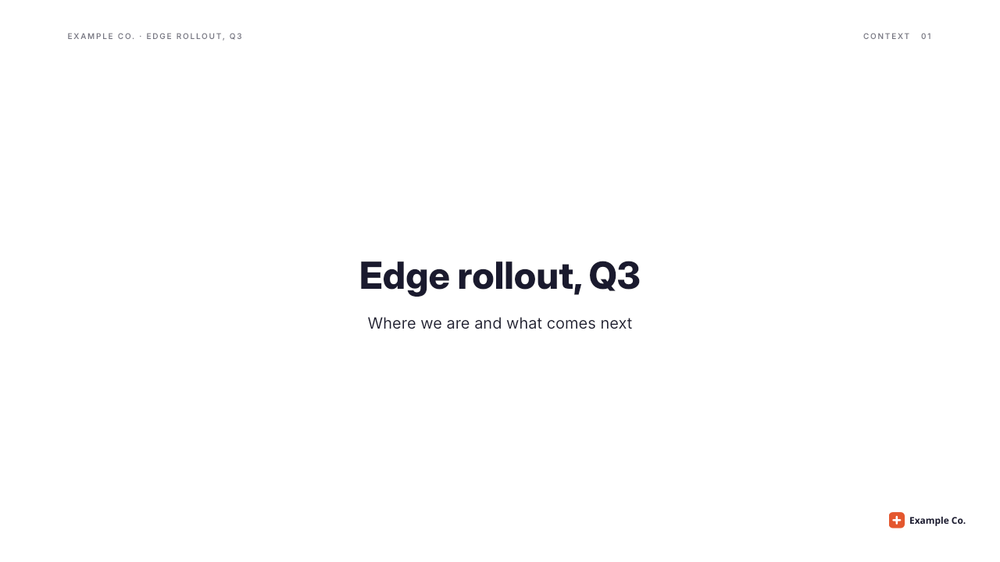
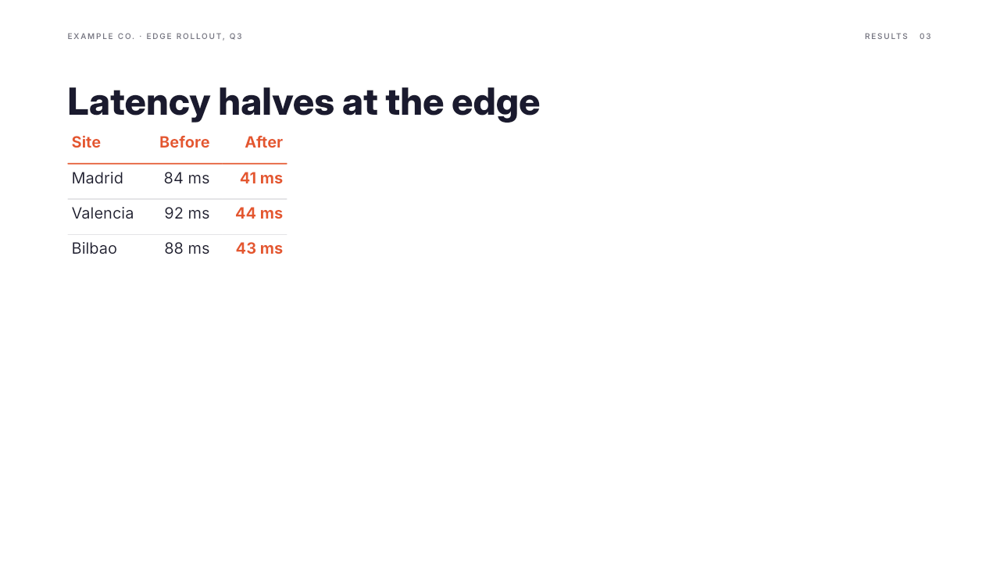
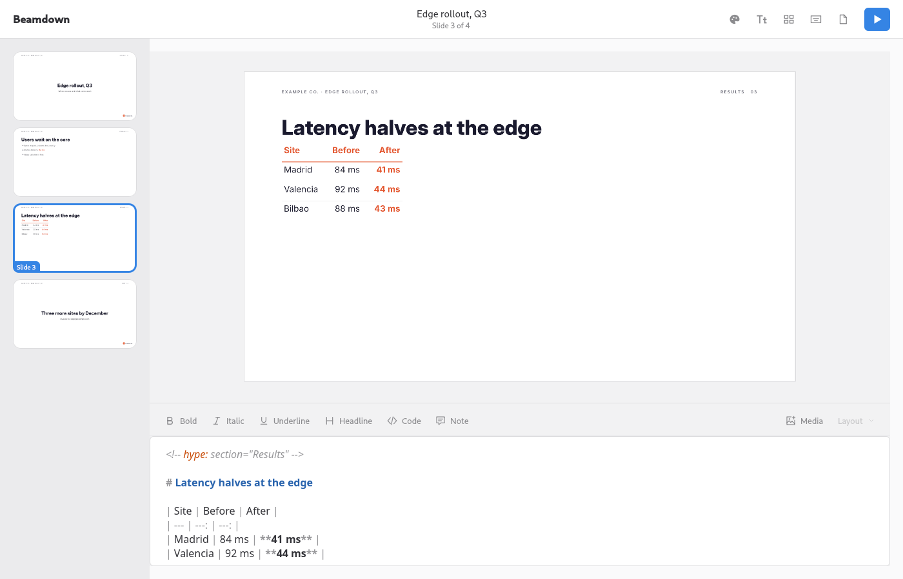

# Draft with your agent

The quickest way to a good deck: **your agent writes the first draft from your notes and your brand guidelines, and you finish it in Beamdown.** The agent handles the blank page, the structure and the brand. You make the choices only you can make: what to cut, what to say louder, which picture tells the story.



This works because a Beamdown presentation is just a Markdown file. An agent can write it, check it and look at it without a display, and the editor picks up its changes the moment they're saved.

## 1. Teach your agent Beamdown

Run this once:

```sh
beamdown skill install
```

It copies a short skill to `~/.agents/skills/beamdown/`, where Codex finds it, and links it into `~/.claude/skills/` for Claude Code. The skill tells the agent to read `beamdown help format`, follow your brand guidelines, check its work, look at the slides it renders, and hand the deck over to you.

## 2. Write your brand guidelines once

Put a `BRAND.md` beside your presentations, or in a folder above them, so every deck there follows it. Write it for a person: colors, type, what every deck has, and how slides should read. The agent turns the colors and type into the deck's front matter and applies the rest as it writes.

??? example "An example `BRAND.md`"

    ```markdown
    --8<-- "examples/brand/BRAND.md"
    ```

From that file, the agent writes front matter like this:

```markdown
---
title: "Edge rollout, Q3"
font: "Inter"
heading_font: "Inter Display"
heading_weight: 800
text_size: 30
heading_size: 72
header: "Example Co. · Edge rollout, Q3"
color_background: "#ffffff"
color_foreground: "#1a1a2e"
color_accent: "#e4572e"
color_dark_foreground: "#6b6b80"
---
```

!!! note "Beamdown doesn't read `BRAND.md` itself"
    The brand reaches the slides through the front matter the agent writes: colors, fonts, text sizes and the running header (see [Themes and typography](themes.md)). Content rules such as bullets per slide or where the logo goes are up to the agent, and up to you when you review.

## 3. Ask for a draft

Give the agent what the talk is about, and let it do the first pass:

```text
Using the beamdown skill and our BRAND.md, draft talk/presentation.md:
a 10-minute update on the edge rollout, from notes.md. Check it, and render
every slide and look at it before you hand it over.
```

The agent starts the deck with `beamdown new`, writes the slides, fixes what `beamdown check` reports, and renders the slides to look at the layout. Here is a draft written that way from the example guidelines:

<div class="grid" markdown>





</div>

The whole deck is in [`examples/brand`](https://github.com/sergio-gimenez/beamdown/tree/fork/examples/brand).

## 4. Make it yours

```sh
beamdown open talk/presentation.md
```



Now it's your presentation. Drag slides into a better order, rewrite a headline, paste a real photo over a placeholder, try a different layout from the **Layout** menu, or press **Ctrl+F** to find the word you want to change everywhere. See [The editor](editor.md) for everything it does.

You can keep the agent in the loop. If it edits the file while the deck is open, its changes appear in the editor right away, and you stay on the slide you're viewing. **Ctrl+Z** undoes its change like any other, and the editor never overwrites edits you haven't saved. Ask for "a backup slide with the raw numbers" or "shorter bullets on slide 4", and keep going.

When it's ready, press **F5** to present, or **Ctrl+E** to export a PDF. See [Present and export](present.md).
