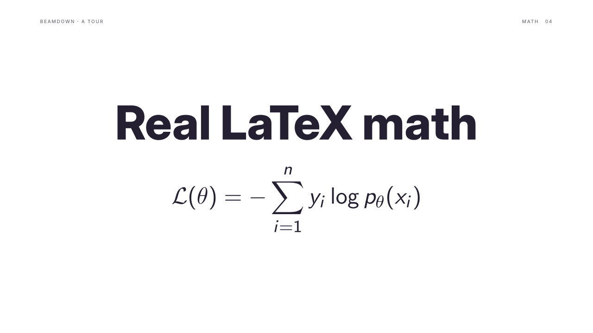

# Beamer features

Beamer got a lot right for technical talks. Beamdown keeps those ideas, written the way pandoc writes Beamer slides, and shows the result as you type.

## Build steps

Build a slide up point by point, written as pandoc writes beamer slides. A line holding only `. . .` pauses: what follows appears on the next click. `incremental: true` in the front matter reveals every list an item at a time, and `::: incremental` or `::: nonincremental` around a list turns that on or off for it alone. A picture after a pause appears on its own step. Each step is laid out as the finished slide, so nothing moves as it grows. The editor shows the finished slide. A PDF gives every step a page, as beamer does, so it can be presented from any PDF viewer; for a handout with one finished page per slide, add `handout: true` (or pandoc's `classoption: handout`) to the front matter, or export with `beamdown export talk.pdf --handout`. PowerPoint exports show finished slides.

## Math

Write math as in pandoc: `$E = mc^2$` in a line and `$$…$$` displayed. Real LaTeX sets it, in beamer's sans-serif math by default or its serif math with `math_font: serif`, with `amsmath`, `amssymb`, `mathtools`, and `bm` loaded. Formulas sit on the text's baseline at its size, take its color, and stay vector in PDF. It needs `latex` and `dvisvgm` from TeX Live; each formula is typeset once and cached in `~/.cache/beamdown/math`, and `beamdown check` names any formula LaTeX rejects.

## Sections, running header and slide numbers

`header: "Company · Proposal"` adds a small running header with the slide's section and number on the right; name a slide's section with `<!-- hype: section="Context" -->`, and move its text with `vertical="center"` or `vertical="bottom"`.

## Hidden backup slides

Keep a backup slide without showing it: right-click it and choose Hide slide, or add `hidden="true"` to its `hype` comment. A hidden slide stays in the deck, dimmed in the sidebar, but presenting skips it and PDF and PowerPoint exports leave it out; `beamdown export --include-hidden` keeps it.
