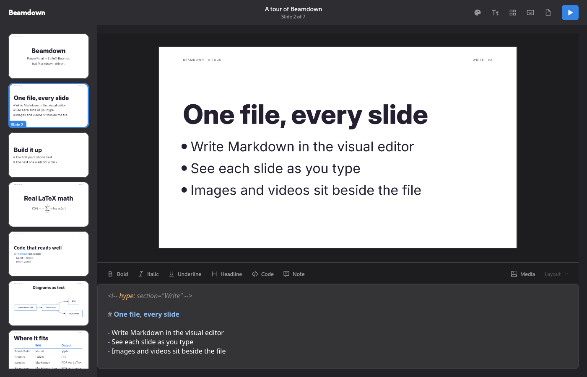

# The editor

Open Beamdown from your app launcher. It reopens your last presentation; use **Ctrl+N** to start a new one, or **Ctrl+O** to choose a Markdown file.

In **Visual** mode, select a slide in the sidebar and write its Markdown below the preview. Changes appear as you type. Drag the divider, or the empty part of the formatting bar under it, to give the preview or editor more room, or press **Ctrl+Alt+Up** / **Ctrl+Alt+Down**; **Ctrl+Alt+E** makes the editor tall for long speaker notes and back. Beamdown remembers the height. Two buttons in the top bar switch modes. The grid button, or **Ctrl+M**, turns the **Overview** on and off, returning to the mode you came from. The button beside it shows a slide in **Visual** mode and `#` in **Markdown** mode; click it, or press **Ctrl+.**, to switch between them. Markdown mode edits the whole presentation, with the same formatting bar on top.

**Overview** mode fills the window with a grid of every slide. Select, rearrange, duplicate, and delete slides there as you would in the sidebar; the up and down arrows move by a row. Double-click a slide or press **Enter** to open it in Visual mode.

The buttons above the editor apply bold, italic, underline, headlines, code blocks, and hidden comments to your selection. Beamdown reads `*asterisks*` as italic and `_underscores_` as underline. **Media** adds an image or video; **Layout** opens its layout and background options.

Press **Ctrl+F** to find text in the slide you are editing, or **Ctrl+Shift+F** to find it in every slide; **All slides** in the find bar switches between the two. Matching ignores case. **Enter** or **Down** goes to the next match and **Shift+Enter** or **Up** to the previous one, changing slides as it goes. **Escape** closes the bar and leaves the match selected in the editor. In Markdown mode both shortcuts search the whole presentation.

Use **Ctrl+Enter** or right-click a slide to add a slide after the selection. Drag slides to rearrange them—their Markdown moves with them. Hold a dragged slide near the top or bottom of the sidebar or overview to scroll further. Select several slides with **Shift+click** or **Shift+arrows** to move, duplicate, or delete them together.

Beamdown saves automatically after a one-second typing pause, or every five seconds while you keep typing. Use **Ctrl+S** to choose a file for a new presentation or save immediately. Beamdown remembers the last directory you opened or saved to.

Every saved version stays in `.hype-backups/` beside your presentation (the folder keeps Hype's name, so both apps share it). Beamdown also keeps local recovery snapshots, including unfinished Markdown and unnamed presentations, and restores your latest draft when you reopen after a crash. Choose **Version history** from the file menu in the top bar to restore an earlier snapshot; your current version remains available there too. Recovery snapshots contain Markdown and slide boundaries, not copies of images or videos. Unfinished code fences are backed up without replacing the last valid presentation file. Finish them before exporting; Beamdown checks that every slide will be preserved.

Local recovery snapshots live in `~/.local/state/beamdown/recovery/` (under `$XDG_STATE_HOME` if set). You can also recover a `.hype-backups/` version manually: copy its `.bak` file to a new `.md` file and open it.
