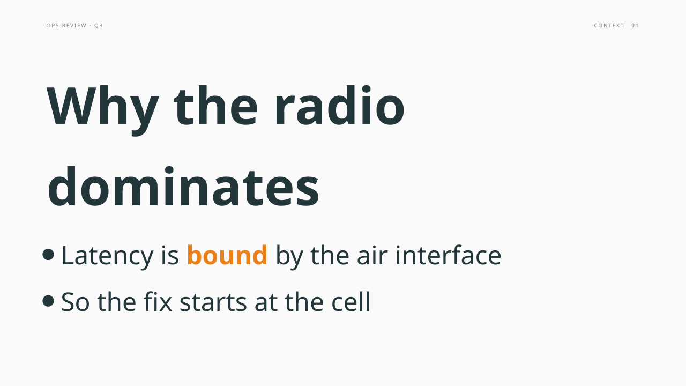

<div class="bd-hero" markdown>


# Beamdown { .bd-hero__title }

<p class="bd-hero__tagline">PowerPoint + LaTeX Beamer, <span>but Markdown-driven,</span><br>for the agentic era.</p>

<p class="bd-hero__lede">A presentation app for GNOME. Your agent drafts the deck in Markdown, following your brand guidelines. You finish it in a visual editor, and export to PDF or PowerPoint.</p>

[Get started](start.md){ .md-button .md-button--primary }
[View on GitHub](https://github.com/sergio-gimenez/beamdown){ .md-button }

</div>

<figure class="bd-shot" markdown>


</figure>

## How it works

<div class="grid cards bd-steps" markdown>

-   :lucide-bot: **1. Your agent drafts**

    ---

    From your notes and your `BRAND.md`, it writes `presentation.md`, fixes what `beamdown check` finds, and looks at every slide it renders.

-   :lucide-pencil: **2. You make it yours**

    ---

    Open the draft in Beamdown: reorder, retype and restyle, and see each slide change as you type. The agent can keep editing alongside you.

-   :lucide-presentation: **3. You present**

    ---

    Present full screen with Presenter View, or export a PDF or a PowerPoint file in your brand.

</div>

[Draft with your agent](agents.md){ .md-button .md-button--primary }

## What you get

<div class="grid cards bd-features" markdown>

-   :lucide-file-text: **One Markdown file**

    ---

    Slides are separated by `---`, with images and videos beside the file. Edit it in Beamdown, in your editor, or let an agent write it.

-   :lucide-layers: **Beamer's toolbox**

    ---

    Build steps with `. . .`, real LaTeX math, sections with a running header and slide numbers, and a PDF page per step.

-   :lucide-mouse-pointer-click: **A visual editor**

    ---

    A live preview, drag-and-drop slides, an overview grid, find in every slide, and Markdown colored as you type.

-   :lucide-palette: **Looks at home on GNOME**

    ---

    Follows your dark style and accent color. Six slide themes built in, from clean Adwaita to Metropolis and classic Beamer blue.

-   :lucide-git-branch: **Diagrams and code**

    ---

    Mermaid and SVG drawn in the deck's colors, and highlighted code, all kept as vectors in the PDF.

-   :lucide-presentation: **PDF and PowerPoint**

    ---

    Present full screen with Presenter View, or export a PDF or a `.pptx` that looks the same on any computer.

</div>

## Write this, get slides

=== "presentation.md"

    ````markdown
    ---
    title: "Why the radio dominates"
    theme: metropolis
    header: "Ops review · Q3"
    ---

    <!-- hype: section="Context" -->

    # Why the radio dominates

    - Latency is **bound** by the air interface

    . . .

    - So the fix starts at the cell

    ---

    # The model

    $$
    T = T_{\text{air}} + T_{\text{core}}
    $$
    ````

=== "What you see"

    

[Take the tour](write.md){ .md-button } [Why Beamdown?](why.md){ .md-button }
