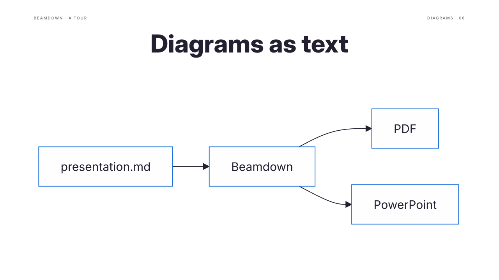

# Images, video and diagrams



Paste an image or a copied image/video file with **Ctrl+V**. Beamdown asks for a name, saves the file, and adds it to the selected slide. Pasting onto a slide that already has media replaces that media while keeping the text. You can also drag a file onto the preview or use **+ Image / video** to replace the media. Dropping several files puts each additional file on a new slide.

Pasted still images are sized for a 4K slide without upscaling. Fitted images stay within 3840 × 2160; spanning images retain enough resolution to fill that area without discarding the parts outside the crop. Beamdown chooses a lossless PNG or WebP, keeping an existing file when it is already smaller and needs no resizing. Original files, videos, animated images, and SVGs are left intact.

Compression runs in the background. If it takes longer than a second, a progress bar appears over the slide; you can cancel the paste or wait for the filename prompt.

Media lives beside the Markdown file:

```text
my-talk/
  presentation.md
  images/
    city.jpg
    diagram.png
  videos/
    demo.mp4
```

Use just the filename; Beamdown finds the right directory:

```markdown


---


# A headline over a background

---


```

A lone image fits without cropping. Text on an image slide is always overlaid, with white lettering, subtle darkening, and a very light blur of the picture for readability. The text stays sharp, and pictures without text stay unblurred. An image with a headline spans by default; `fit` or `background=blur` keeps the whole image visible beneath the text. Videos fit the slide and play once when you reach them during a presentation.

Choose **Fit** or **Span** from the **Layout** menu above the editor, or put layout options inside the brackets:

| Markdown | Result |
| --- | --- |
| `` | Show the whole image, with text overlaid |
| `` | Fill the slide, cropping as needed |
| `` | Loop a video without sound |
| `` | Wait for Space to play the video |

For images that leave space around them, Beamdown matches the background to the image’s edge color when possible. Choose **White**, **Black**, or **Use theme color** from the **Layout** menu to override it, or specify any color: ``. Choosing White or Black also switches spanning media to fit so the background is visible.

Choose **Background → Blurred image** to fill the slide with a stretched, blurred copy behind the sharp fitted image: ``. The same background appears in PDF and PowerPoint exports. Animated images use their first frame for the blurred background.

For videos, choose **Background → Blurred first frame**, or write ``. The video plays over a still blur of its first frame, even when you specify a different poster image. Choosing blur also switches spanning media to fit so the background is visible.

**Background → Match image edges** also works with videos: ``. It samples the edges of the first frame and keeps that background color during playback, even with a custom poster. Selecting it switches spanning videos to fit.

To put a small image such as a logo in a corner, choose **Place** from the **Layout** menu and pick a position, then choose a **Size**. You can also write it in the brackets: ``. Positions are `top-left`, `top`, `top-right`, `left`, `center`, `right`, `bottom-left`, `bottom`, and `bottom-right`. The size is the share of the slide the image may fill, from 1% to 100%, and defaults to 10% (Small). A placed image keeps its shape and sits just inside the slide edge. The slide's text and theme colors stay as they are, without darkening or white lettering. Placement works with still and animated images, not videos, and replaces `fit`, `span`, and background choices; choosing **Fit** or **Span** removes it. Pasting or dropping a new image onto a placed slide keeps its position and size, so swapping a logo is one step. Pasted images retain enough detail to enlarge them later.

To put text beside a picture instead of over it, split the slide: `` puts the image on the left half and the text on the right, `` gives the image the right 40%, and `` keeps a headline on top with the image filling the rest. The text keeps the theme's colors, without darkening or white lettering, and reads from the left in a side column. Add `background=#e4dfd7` to color the image's side of the slide edge to edge. Split works with still and animated images, not videos, and cannot be combined with `fit`, `span`, `position`, or `overlay`. Replacing the image keeps its side, share, and color.

To draw something yourself, write SVG in an `svg` code block. It takes the place of the slide's image, stays sharp, and stays vector in PDF. Name the theme's colors as `var(--accent)`, `var(--foreground)`, and so on, and the drawing follows the theme; shapes and text without colors of their own take the theme's text color, and text takes the presentation's font:

````markdown
# Requests per second

```svg
<svg viewBox="0 0 300 120">
  <rect x="20" y="60" width="60" height="60" fill="var(--dark-foreground)"/>
  <rect x="120" y="20" width="60" height="100" fill="var(--accent)"/>
</svg>
```
````

Fix a word in a diagram without leaving the slide: double-click a label in an SVG image, type, and press Enter (Escape cancels). Beamdown rewrites only that label's text in the file in `images/`, so the rest of the SVG stays exactly as it was written, and Ctrl+Z puts the file back. This works for labels written as one `<text>` at an `x` and `y` with no `<tspan>` or `transform`, which is how agents draw; it is for retyping, not for moving shapes, and labels in an `svg` code block are edited in the Markdown instead.

Draw a diagram as on GitHub with a `mermaid` code block. It takes the image's place like an `svg` block, in the deck's background, text and accent colors and its font, or in one of Mermaid's themes with `mermaid_theme: default` (also `neutral`, `dark`, `forest`). The Mermaid CLI (`mmdc`) lays it out and `pdftocairo` turns it into outlines, so it stays vector in PDF; each diagram is drawn once and cached in `~/.cache/beamdown/mermaid`, and a deck's diagrams are drawn in the background when it opens.

Animated WebP and GIF images play inline in the preview and while presenting. Use the usual image syntax, such as ``, with the file in `images/`. Space pauses or resumes animations while presenting; PowerPoint exports automatically convert them to embedded MP4 videos, preserving the slide layout and playback settings. PDF exports capture their first frame.

Each slide supports one image or video. Copy the whole presentation folder when sharing or moving it.
