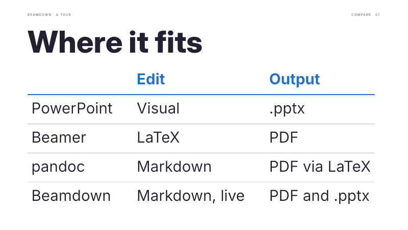
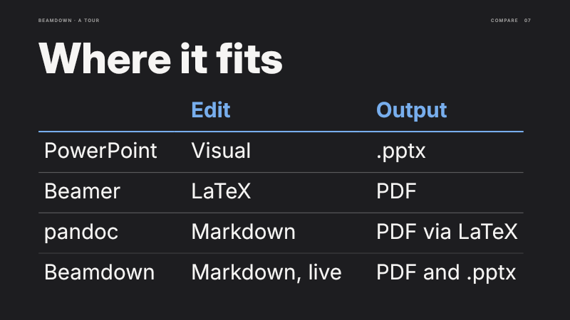
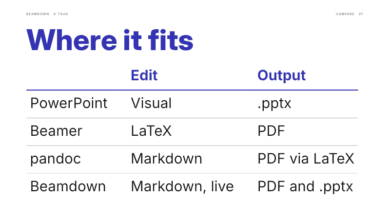
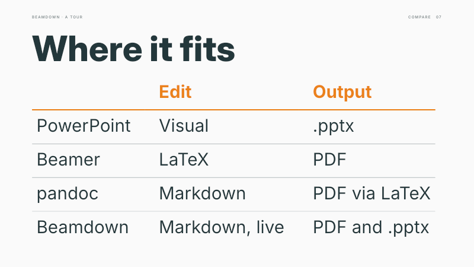
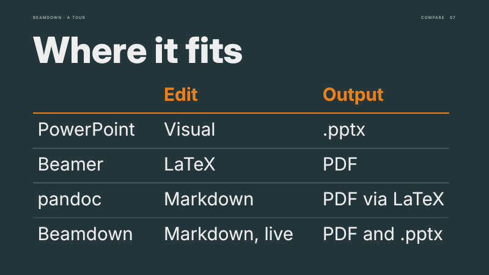
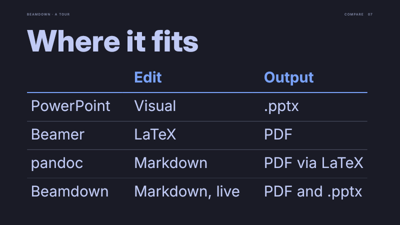

# Themes and typography

The palette and font icons in the toolbar choose a slide theme and a presentation font. Hover to see the current choices. Beamdown ships `adwaita`, `adwaita-dark`, `beamer` (with its blue frame titles), `metropolis`, `metropolis-dark` and `tokyo-night`, and lists any installed Omarchy theme beside them. Theme colors apply to text, code, and slide backgrounds; your images keep their original colors. Code stays monospaced. `color_heading: "#3333b3"` in the front matter colors headings on their own, as beamer colors its frame titles.

{ loading=lazy }

{ loading=lazy }

{ loading=lazy }

{ loading=lazy }

{ loading=lazy }

{ loading=lazy }

From left to right and top to bottom: `adwaita` (the default), `adwaita-dark`, `beamer`, `metropolis`, `metropolis-dark` and `tokyo-night`.

## Your own colors and fonts

Colors and the font choice are saved in the Markdown file. Install the same font on another computer to keep the typography consistent.

Talks want big text that fills each slide; a proposal or brand book wants the same type on every page. Fix it in the front matter: `text_size: 24` sets body text to 24 pixels on a 1080p slide everywhere, headings take `heading_size` (64, say), and text starts at the top of its area so headings line up from slide to slide. Text still shrinks when a slide holds too much, and `beamdown check` says so. `heading_font: "Newsreader"` sets headings in a second font and `heading_weight: 400` sets their weight.

## The app around the slides

Beamdown's own interface follows the desktop independently of the slides: GNOME's dark style and accent color, or the current Omarchy theme, and it updates when you change them. Both editors color the Markdown as you type: headings, emphasis, code, media and links, comments and `hype` directives, front matter, math, and the lines that break, pause and fence slides.

The header shows the presentation's name with your position in it, such as “Slide 4 of 45”; saving and exporting report their progress on that line. The file icon beside it holds New, Open, Save, Export, and Version history, and is highlighted when you have unsaved changes.
