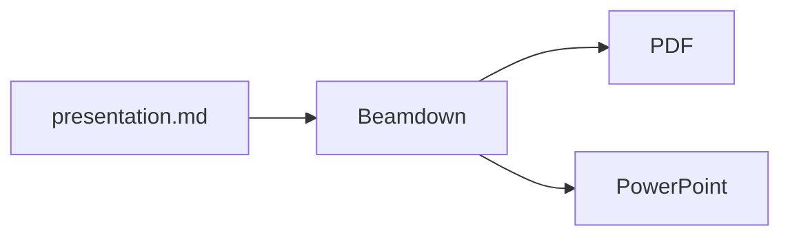

# Beamdown

PowerPoint + LaTeX Beamer,
but Markdown-driven,
for the agentic era.

---

<!-- hype: section="Write" -->

# One file, every slide

- Write Markdown in the visual editor
- See each slide as you type
- Images and videos sit beside the file

---

<!-- hype: section="Build" -->

# Build it up

- The first point shows first

. . .

- The next one waits for a click

---

<!-- hype: section="Math" -->

# Real LaTeX math

$$
\mathcal{L}(\theta) = -\sum_{i=1}^{n} y_i \log p_\theta(x_i)
$$

---

<!-- hype: section="Code" -->

# Code that reads well

```python
def handover(ue, target):
    ue.cell = target
    return ue.cell
```

---

<!-- hype: section="Diagrams" -->

# Diagrams as text



---

<!-- hype: section="Compare" -->

# Where it fits

| | Edit | Output |
| --- | --- | --- |
| PowerPoint | Visual | .pptx |
| Beamer | LaTeX | PDF |
| pandoc | Markdown | PDF via LaTeX |
| Beamdown | Markdown, live | PDF and .pptx |
